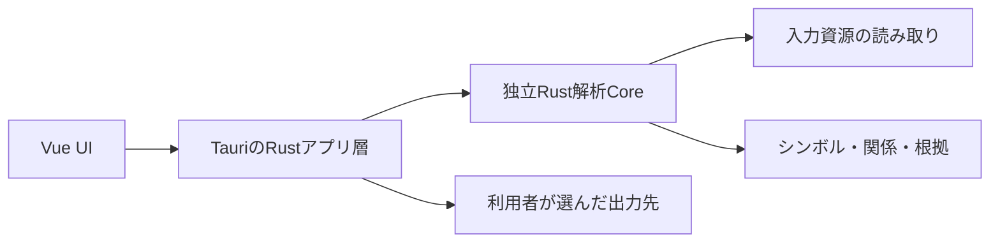

# legacists 設計書

[要件定義書](requirements.md)の実現方法を管理する。[設計Issue #2](https://github.com/kz-oshiro/legacists/issues/2)は設計完了で閉じ、製品実装・全体検証・公開は[後続Issue](development.md#開発の進め方)で扱う。

## 設計の現在地

初期版の実装へ引き継ぐ確定設計。Vue UI・Rustバックエンドと将来分離できる解析Coreの構成、E2EのPlaywright採用はユーザー指定による。以下の契約・規則・保存形式・試験手順を実装基準とし、変更が必要なら設計と影響する試験を一緒に更新する。#2完了時点では製品コード・依存lockfile・試験基盤は未作成だった。現在の実装と確認結果は#3を参照し、設計確定を製品の動作確認とは扱わない。

| 区分 | 状態 |
| --- | --- |
| 既決の条件 | 単一リポジトリ、Vue UI／Rustバックエンドの分離、将来分離できる独立Rust解析Core、Playwright E2E、Windows 11 x64、既存WebView2、ZIP内EXE一つ、入力UTF-8／SJIS系、ファイル単位の明示的参照 |
| 確定した設計 | 入力境界、解析スナップショット、公開Core APIとIPC、抽出・解決規則、画面操作、文字コード、TXT、設定移行・削除、診断、個別試験・測定手順 |
| 別Issueに残る決定 | #6の性能目標・端末・データ規模・回数、#10のローカル試験の共通運用方針。下記の受け渡し契約に従い、#6の性能基盤・#3の性能以外の基盤・#4の判定へ反映する。未確定を試験成功としない |
| 別工程 | #3で製品実装・依存固定・開発時試験とビルド、#6で性能データの生成器・測定器・固定データの実装、#4で全体検証・実測、#5で公開。初期版の実EXE結合試験は利用者判断で必須条件から除外し、GitHub Actionsの共通運用は対象外。#7・#9の追加機能、#8の公開方針は独立管理 |

対象システムのフレームワークと版は不明のまま扱う。標準のJava／JSP／Servlet設定と直接記載の合成例を設計の出発点にし、実案件がその構成だとは断定しない。必須範囲を採用ライブラリの制限に合わせて縮小しない。

## 構成と依存方向

UIはVue、解析はバックエンドのRustに置く。アプリとCoreは単一リポジトリで管理し、`Vue UI → Tauriのアプリ層 → Rust解析Core`の三層に分ける。Rust Coreは初期実装から独立したライブラリクレートにし、将来別のリポジトリやRustアプリへ切り出せる構成にする。Tauriはアプリ側のアダプターであり、Coreへ依存する。Coreからアプリ・Vue・Tauriへは依存させない。CLIが必要になった場合も同じ公開Core APIを呼ぶ。

```text
legacists/
├── crates/
│   └── legacists-core/       # 独立ライブラリ。公開API・モデル・解析・問い合わせ・TXT構築
│       ├── Cargo.toml        # Core自身の依存と同梱資材を定義
│       ├── src/             # lib・input・analysis・model・query・export・diagnostics
│       └── tests/           # GUI不要の公開API試験・合成例
├── apps/
│   └── desktop/
│       ├── src/             # Vue画面・表示状態・IPCクライアント／通信型
│       └── src-tauri/       # Rustアプリ層。IPC・ジョブ・設定・OS操作・Core呼び出し
├── xtask/                   # 将来の共通実行入口
├── test-support/            # 将来の合成データ・生成器
└── docs/
```

上記は予定配置。初期段階で空のクレートや未使用のCLIを増やさない。Core内部は責務ごとのモジュールに分け、不要なクレート分割は行わない。TXT生成はまずCoreの出力モジュールとし、保存先の選択・書き込みはアプリ側で扱う。Coreの別リポジトリ化・独立配布・CLI提供そのものは今回実施せず、必要になった段階で別Issueとして扱う。



| 部分 | 責務 | 持たせない責務 |
| --- | --- | --- |
| Rust解析Core | ファイル列挙・復号、構文解析、シンボル抽出、参照解決、診断、問い合わせ、出力内容の構築 | Vue・Tauriの型、IPCコマンド／イベント、画面状態、OSダイアログ、設定の永続化、外部AIへの接続 |
| Rustアプリ層 | 選択されたプロジェクトとスナップショットの管理、ジョブ実行、IPC検証・通信型への変換、設定・保存先・OS操作の制御 | 独自の抽出・参照解決規則、Core内部モジュールへの直接アクセス |
| Vue UI | ツリー・検索・グラフ・ソース・出力対象の表示と操作、表示状態、IPCクライアント | 解析・参照解決・文字コード判定・TXT分割の再実装、全AST・全ソース・全グラフの常時保持、任意のOS操作 |

### Coreを将来分離するための境界

- 公開境界は`legacists-core`の`lib.rs`から提供する入力設定・解析スナップショット・問い合わせ・診断・出力計画とそのAPIに絞る。パーサーのASTや内部索引を公開APIへ出さず、アプリ側は公開APIだけを呼ぶ。
- Coreの必須依存・文法・合成例・ビルド資材はCore自身から参照できるようにする。アプリ側のパス依存、`include_str!`等による画面資材の参照、フロントエンドを呼ぶビルド処理を持たせない。workspaceの共通設定を使う場合も、Core移動時に明示できるビルド設定に留める。
- プロジェクトのルート・Webルート・除外・文字コード指定・出力条件は呼び出し側から値として渡す。CoreはTauriの管理状態やアプリの設定ファイル、既定保存先、プロセス全体の環境変数を解析条件として暗黙に読まない。
- 入力列挙・読み取りはCoreで定める境界を通し、ローカルファイル用の実装と合成入力・障害用の実装を差し替えられるようにする。[入力範囲の検証](#入力の境界)も維持する。進捗・キャンセルはCoreの型とコールバック等で受け、Tauriへのイベント送信や非同期ランタイムへのジョブ投入はアプリ側で行う。
- Coreはアプリの設定領域やTXTの保存先へ書き込まない。診断とTXTの内容を構築して返し、アプリ側が版・実行環境・保存先を付けて表示・保存する。公開APIのエラーはCoreの原因区分として返し、IPC用の応答形式と混同しない。
- 独立性は[Coreの分離確認](#coreの分離確認)で確かめる。VueやTauriを外しても同じ解析を利用できることを条件とし、将来のCLIや別GUIの先行実装は要求しない。

## 技術の採用状況

VueをUI、Rustを解析バックエンドに使う。2026-10-12に公式資料・配布メタデータ・公開ソースを照合し、下表を初期実装の採用構成とした。採用版は#3の依存解決の開始値とし、実際の推移依存・機能・資材はlockfileとビルドで固定する。互換性確認は公開契約の照合であり、組み合わせを導入・ビルドした証拠ではない。

| 項目 | 採用する版・直接依存のライセンス | 選定理由・確認境界 |
| --- | --- | --- |
| デスクトップ | Tauri 2.12.3、tauri-build 2.7.2、@tauri-apps/api 2.12.3、CLI 2.12.2（MIT OR Apache-2.0） | Rust Coreを直接利用できる。Tauriの必要Rust版は1.90以上。単一EXEの構築条件は下記、実際のビルド・起動証拠は#3 |
| フロントエンド | Vue 3.5.43、Vite 8.3.4、@vitejs/plugin-vue 6.0.10、vue-tsc 3.3.13、@types/node 24.19.2（MIT）、TypeScript 5.9.3（Apache-2.0） | 表示と操作を担当。plugin-vueのVue ^3.2.25・Vite ^8、vue-tscのTypeScript >=5に適合。型検査はvue-tscで独立実行。TypeScript 7は下記の理由で採用しない |
| ペイン配置 | dockview-vue 8.5.1（MIT） | タブ・分割・サイズ変更を担当。peer dependencyのVue ^3.4.0に採用版は適合。別製品のEnterprise機能は構成へ含めない |
| ソース表示 | Monaco Editor 0.57.0（MIT） | 読み取り専用表示、行・列移動。言語サービスによる解析結果をCoreの参照関係に混ぜない。workerをローカル同梱 |
| グラフ表示 | Cytoscape.js 3.34.3（MIT） | Coreが返す集約・近傍だけを描画。組み込みレイアウトから始め、追加レイアウト依存は必要性が出てから判断 |
| Java／JS構文解析 | tree-sitter 0.27.1、tree-sitter-java 0.23.5、tree-sitter-javascript 0.25.0（MIT） | Rustへ静的リンク。runtimeの対応ABI 13〜15にJava 14・JS 15が適合。構文・位置・エラー回復はT-02〜T-05・T-08で確認 |
| XML | quick-xml 0.42.0（MIT） | 名前空間と位置を保持して設定を読む。外部DTD・外部実体を取得しない。寛容なJSP／HTMLの読み取りと分ける |
| 復号 | encoding_rs 0.8.42（(MIT OR Apache-2.0) AND BSD-3-Clause） | SHIFT_JISを置換なしで復号し、CP932拡張文字をT-07で確認。UTF-8はRustの厳密検査を使用 |
| OSダイアログ | tauri-plugin-dialog 2.8.2（MIT OR Apache-2.0） | Rust APIだけをアプリ層で使用。tauri ^2.12・Rust 1.90以上の条件に適合。任意パス操作のJavaScript APIを公開しない |

主な確認元: [Tauri設定](https://v2.tauri.app/reference/config/)、[VueのTypeScript対応](https://vuejs.org/guide/typescript/overview)、[Dockviewのライセンス区分](https://github.com/dockview/dockview/blob/master/LICENCE.md)、[Monaco](https://github.com/microsoft/monaco-editor)、[Cytoscape.js](https://js.cytoscape.org/)、[Tree-sitter Rust API](https://docs.rs/tree-sitter/)、[Java文法](https://github.com/tree-sitter/tree-sitter-java)、[JS文法](https://github.com/tree-sitter/tree-sitter-javascript)、[quick-xml](https://docs.rs/quick-xml/)、[encoding_rs](https://docs.rs/encoding_rs/)。版とライセンスの配布情報は各公式リポジトリが案内するnpm／crates.ioを参照した。

E2Eにはユーザー指定に従ってPlaywright Testを採用し、初期実装は[@playwright/test 1.64.0](https://registry.npmjs.org/@playwright/test/1.64.0)（Apache-2.0、Node.js 20以上）を起点とする。[共通の採用方針](development.md#e2eの採用方針)に従い、T-18を画面フロー、T-19を実EXE E2Eの入口とする。試験用Chromiumはこの版に対応するリビジョンを#3で固定し、実EXEでは端末の既存WebView2を使う。依存追加・試験実行は未実施。

TypeScript 7.0.2の配布物はnative CLIで、従来のJavaScript APIの入口がない。一方、採用する[vue-tscのソース](https://unpkg.com/vue-tsc@3.3.13/index.js)は`typescript/lib/tsc`とJavaScript APIを使うため、[TypeScript 5.9.3の配布物](https://registry.npmjs.org/typescript/5.9.3)を選ぶ。Vite・plugin-vueのNode条件は`^20.19.0 || >=22.12.0`。開発時はNode 24.21.0 LTS・同梱npm 11.19.0、Rust 1.99.0／MSVCを採用開始値とする。確認元は[Node公式配布情報](https://nodejs.org/dist/index.json)、[Rust stable manifest](https://static.rust-lang.org/dist/channel-rust-stable.toml)。インストールや端末の変更は#3のセットアップで行う。

Tree-sitter ABIは[runtimeの公開ヘッダー](https://github.com/tree-sitter/tree-sitter/blob/v0.27.1/lib/include/tree_sitter/api.h)、[Java生成パーサー](https://github.com/tree-sitter/tree-sitter-java/blob/v0.23.5/src/parser.c)、[JS生成パーサー](https://github.com/tree-sitter/tree-sitter-javascript/blob/v0.25.0/src/parser.c)を照合した。キャンセルには`parse_with_options`のprogress callbackを使い、JSP・設定の走査も読み取り区切りで中断を確認する。

正規表現だけのJava／JS解析は、コメント・文字列と型・参照を区別しにくいため主方式にしない。JVMや外部Language Serverを起動する方式は追加環境・非実行の条件に合わない。JSPは混在領域を分離し、XMLパーサーだけで全体を読む方式にしない。

採用判断では公式リポジトリ・安定版配布の存在、peer／Rust版条件、上記API・ABIとライセンスを確認した。2026-10-12の[OSV API](https://google.github.io/osv.dev/api/)による指定した主要直接依存版の照会では該当アドバイザリは返らなかった。この範囲を推移依存・利用端末・完成製品の安全性検査へ読み替えない。#3ではlockfileを固定してRust／Nodeの依存検査とライセンス本文・NOTICE等の収集を行う。MIT・BSDの著作権／許諾表示、Apache-2.0のライセンス・該当するNOTICEをアプリ内に収める。本体のライセンスは#8で決定する。依存更新や組み合わせの不成功で設計が変わる場合は#2を再開して影響を確認する。

## 入力の境界

- 一度に一つの基準フォルダを開く。初期の対象拡張子は`.java`・`.jsp`・`.jspf`・`.jspx`・`.xhtml`・`.js`・`.mjs`・`.cjs`・`.xml`・`.properties`。拡張子の比較は大文字小文字を区別しない。
- 基準フォルダから通常ファイルを再帰列挙する。既定除外は`.git`・`.svn`・`node_modules`・`target`・`build`・`dist`のフォルダ名。画面に適用中の除外を示し、利用者が解除・追加できる。`.gitignore`を暗黙に解析条件へ取り込まない。
- 除外追加は基準フォルダからの相対フォルダ／ファイルを明示指定する方式から始める。対象外拡張子、除外、読み取り失敗、リンク除外の件数と理由を分ける。深いツリーはページ単位で取得する。
- ジャンクション・シンボリックリンクなどのreparse pointは追跡しない。`..`、絶対パス、UNC、URLが指すプロジェクト外を読み込まない。列挙後の差し替えにも備え、開いたハンドルの最終パスとファイル種別で範囲を再確認する。
- 入力は読み取り専用で開く。Java／JS、ビルド、マクロ、外部設定の実行・取得は行わない。アーカイブやJAR内部は展開しない。外部依存が見つからなくても、プロジェクト内の関係が存在しないとは判断しない。
- Webの`/`起点はWebルートから解決する。`WEB-INF/web.xml`の親の親が一つなら自動候補とし、複数なら選択を求める。設定画面でプロジェクト内フォルダを指定でき、未指定の間はルート相対の参照を未解決にする。Maven／Gradleの実行による推定は行わない。

## 解析の流れ

1. プロジェクトの基準フォルダと対象・除外条件を確定し、[入力の境界](#入力の境界)に従って読み取る資源を列挙する。
2. ファイルごとにUTF-8・SJIS系（CP932を含む）を判定し、手動指定で修正できるようにする。初期版ではほかの文字コードを追加しない。復号後に言語ごとの構文解析を行い、復号失敗と未対応構文を別の診断として残す。置換文字で読み取り成功にしない。
3. シンボル索引を使って参照先を解決する。JSP・XHTMLの参照、JS・form送信、XML・プロパティ設定とJavaの連携は、対応すると定めた記法・設定形式ごとの規則として追加する。
4. 根拠付きのグラフと診断を作り、概要集約・近傍探索・参照元／参照先の問い合わせに使用する。
5. ツリーやグラフで一件ずつ手動選択したファイルからTXTを構築し、確認後に指定された場所へ保存する。関連ファイルを自動追加しない。

入力コードやビルドスクリプトを実行して解決しない。初期版は[確定した参照関係の範囲](requirements.md#初期版の参照関係の範囲)を対象とする。候補が複数ある関係や未解決は、確定した関係と区別する。個別記法の解決規則と合成例は下記を実装基準とする。実行時に組み立てる参照・リフレクション・フレームワーク固有の間接参照の解決は必須条件にせず、採否を#9へ分ける。

XML・プロパティの値は、採用した設定形式の規則に基づいて参照として扱う。設定値を一律に依存関係へ変換しない。設定を介した関係では、参照元と対応する設定の記述を根拠として確認できるようにし、解決できない値や識別子を推測で確定しない。ファイルパス・クラス名の直接記載と、設定に明記されたURLとJava・画面の対応を必須範囲として、下記の記法と解決規則を実装する。フレームワーク固有の間接参照は#9で扱う。

## 解析スナップショットと更新

`ProjectId`はフォルダを開くたびに発行し、`JobId`は解析要求ごと、`SnapshotId`は公開可能な解析結果ごとに発行する。IDは外部へ意味を持たない文字列で、パスの代用としてOS操作に使わない。

1. `Idle → Running`でファイル一覧・設定の版を固定し、読み取った生バイトのSHA-256、復号本文、根拠、診断をメモリ内へ保持する。各ファイルの読み取り前後の情報が変化した場合は、安定して読み直せなければ読み取り失敗にする。
2. 列挙・復号・抽出・解決を進捗として返す。ファイル単位の失敗は診断へ記録して継続する。Core全体の内部エラーはジョブを失敗にする。
3. 完了時は`Ready`または診断付きの`ReadyWithDiagnostics`へ移り、結果をまとめて公開する。途中の索引・グラフを完成結果として返さない。
4. 再解析中は前回結果を「更新前」と表示して閲覧できるが、TXT保存は無効にする。成功後にスナップショットを交換する。失敗・キャンセル時は前回を保持し、「再解析未完了」と示す。
5. プロジェクトを閉じると解析・問い合わせを無効にし、本文・AST・索引・出力プレビューを解放する。設定保存には含めない。

キャンセルはCoreへトークンを渡し、列挙・読み取りの区切り、パーサーの中断点、参照解決、出力生成で確認する。長時間の単一ファイル処理でも中断できる設計にし、応答時間の合否は#6で定める。完了／キャンセルの終端通知は一回だけ。`ProjectId`・`JobId`の一致しないイベントはUIで破棄する。

出力前には選択ファイルだけでなく、解析対象全体と列挙・除外条件を再確認する。追加・削除・リネーム・本文変更・文字コード指定変更は関係へ影響するため、差分があれば出力を止めて再解析を案内する。mtime・サイズが一致してもバイトハッシュを照合する。書き込み直前にも確認し、確認後の変更を完全にロックできるとは表示しない。保存する内容は常にメモリ内の同じスナップショットから作る。

## データモデル

| データ | 主な情報 |
| --- | --- |
| `Resource` | `ResourceId`、相対パス、言語、バイトハッシュ、文字コード・判定根拠、`read/decode/parse`の各状態 |
| `Symbol` | `SymbolId`、種類（class/interface/enum/record等）、完全修飾名、所属資源、宣言位置。型パラメーター等は型名の誤認防止にも使う |
| `Relation` | `RelationId`、参照元資源、種類、解決状態、参照先資源または候補ID群・参照文字列、`EvidenceId`群、理由コード |
| `Evidence` | 資源、半開区間の開始／終了位置、抽出規則ID。設定経由の関係は画面側と設定側の複数位置を保持 |
| `Diagnostic` | 安定番号、重大度、対象・位置、処理段階、原因区分、影響、確認・対処・追加報告の定型項目 |
| `Selection` | Coreへ渡す手動選択の`ResourceId`集合。変更の版と永続化はアプリ層で管理。シンボル・関係の選択で自動追加しない |
| `ExportPlan` | `SnapshotId`、正規化済みの選択・出力条件、連番・UTF-8バイト数・本文範囲。アプリ層がプレビューIDと選択・設定の版へ対応付ける |

関係の種別はimport・継承・実装・型の使用・取り込み・スクリプト参照・遷移・設定上の対応などを分ける。importをメソッドの呼び出しと同一視せず、メソッド呼び出し全体の解析を必須条件にしない。解決状態は少なくとも確定・候補・未解決を識別する。

`ResourceId`は同じ開いているプロジェクト内の同じ相対パスに対して安定させ、リネームは別資源とする。シンボル・関係・根拠IDはスナップショット内のみ有効。IPCでは必ず`SnapshotId`と一緒に指定する。保存する選択・文字コード指定はIDではなく相対パスとする。

位置は復号した本文に対するUTF-8バイトオフセット（0始まり）を正本とし、UI向けに行・UTF-16列（1始まり）を返す。CRLFと改行なしの末尾、絵文字、CP932復号後の位置を試験する。JSPの領域抽出やJavaのUnicodeエスケープ前処理は元本文への位置対応を保持する。抜粋はこの本文と位置から表示時に導出し、エラーレポートへ流用しない。

関係は`参照元・種別・参照先または未解決表現・解決状態`が同じものをまとめ、異なる根拠位置を保持する。自己参照もCoreに保持する。グラフ上の本数はこの関係数、根拠数は別の値として表示する。概要はフォルダまたはJavaパッケージで集約し、内部関係とグループ間関係を分ける。集約から元の関係IDへ戻れるようにする。

### 抽出と解決の契約

`confirmed`は対応規則によってプロジェクト内の対象が一意に決まる関係、`candidate`は候補が複数または形式の意味を確定できない関係、`unresolved`は参照を検出したが参照先を特定できない状態とする。未対応構文は資源・範囲の診断で示し、未解決と同一視しない。名前の一致だけでメソッド呼び出しや実行時の遷移を確定しない。

| 規則群 | 抽出する記法 | 解決・制約 |
| --- | --- | --- |
| `JAVA-IMPORT` | 通常／static import、単一／wildcard | 単一importの宣言先クラスが一意なら確定。static importは所有型への関係。wildcardを全クラスへの参照に展開しない |
| `JAVA-TYPE` | extends/implements、フィールド・引数・戻り値・ローカル変数・new・cast・instanceof・型引数・annotation・class literalに現れる型 | 完全修飾名、スコープ内の宣言、単一import、同一packageの規則順に解決。重複定義や規則競合は候補。wildcard由来だけの短い型名は外部classpathがないため候補とし、一つ見つかっただけで確定しない。primitive・型パラメーターは資源参照にしない |
| `JAVA-SYNTAX` | Java 5のgenerics／annotation／enum、Java 8のlambda・method reference、record・sealed class・text blockの合成例 | 古いものと新しいものの両方を検証。全Java版・preview構文への完全対応はうたわない。Unicodeエスケープは字句解析前に処理し位置を戻す。型推論が必要な`var`や式の型を推測しない |
| `JSP-INCLUDE` | `<%@ include file="..." %>`、`<jsp:include page="...">`、`<jsp:forward page="...">`、JSPXの対応する要素 | 静的な文字列をファイル／URL規則で解決。JSPコメントとHTMLコメントを区別。`${...}`・`<%=...%>`を含む値は動的として未解決 |
| `MARKUP-REF` | JSP／XHTMLの`script[src]`、`a[href]`、`form[action]`、`iframe[src]`、Facelets名前空間の`composition/decorate[template]`・`include[src]` | 名前空間URIと属性を確認し、静的値をファイル／URLへ解決。JSP内Javaはpage import・宣言・scriptletの領域を分けてJava規則に渡す。未知のカスタムタグは対応済みとしない |
| `JS-MODULE` | static import、`export ... from`、文字列一つの`require(...)`・`import(...)` | 明示された相対ファイルが一意なら確定。拡張子省略の`.js/.mjs/.cjs`や`index`は実行環境の規則が不明なので候補。ローカル定義の`require`は通常のモジュール参照と確定しない。引数が式なら未解決。bare specifier・aliasは外部モジュール／設定不足と示し、Nodeやbundlerを実行しない |
| `CONFIG-LITERAL` | XMLの属性／要素テキスト、propertiesの値全体に書かれたクラス名・対象拡張子付きのパス | XMLの構造とpropertiesのエスケープを解釈した値から、宣言済み完全修飾名・明示パスを照合。既知のclass／path項目は一意なら確定、未知の項目は文字列一致の候補とする。任意の部分文字列や全設定値を依存へ変換しない |
| `WEBXML-ROUTE` | `servlet-name`と`servlet-class`／`jsp-file`、`servlet-mapping`の`url-pattern`、`welcome-file` | 設定ファイル→Java／画面と、静的な画面URL→マッピング先の関係を作る。完全一致、最長path prefix、extension、defaultの優先順。重複・欠落は候補／未解決。設定経由の根拠をすべて保持 |

既知の汎用設定項目はXMLのlocal nameが`class`・`class-name`・`servlet-class`・`filter-class`・`listener-class`、パスが`file`・`path`・`resource`・`location`・`jsp-file`、propertiesはキーの最終要素が`class`／`className`または`file`／`path`／`resource`とする。標準Servlet設定以外は記法を認識した直接参照として扱い、フレームワークの実行時動作まで保証しない。キー／IDの間接参照や式展開は#9の対象。

XMLは外部実体を展開せず、必要な値に未展開実体があれば未解決と診断する。旧形式のDOCTYPEがあるだけでネットワークへアクセスしない。propertiesは復号後に継続行・区切り・`\uXXXX`を解釈し、根拠は変換前の物理行へ対応付ける。[Java Propertiesの書式](https://docs.oracle.com/en/java/javase/25/docs/api/java.base/java/util/Properties.html)を参照するが、入力バイトの文字コードは本製品のUTF-8／SJIS系の条件を使用する。

JSPの混在・include記法は[Pages仕様](https://jakarta.ee/specifications/pages/4.0/jakarta-server-pages-spec-4.0)、Faceletsの明示的なテンプレート指定は[公式チュートリアル](https://docs.oracle.com/javaee/7/tutorial/jsf-facelets004.htm)と[includeの属性定義](https://docs.oracle.com/javaee/7/javaserver-faces-2-2/vdldocs-facelets/ui/include.html)を照合元にする。これらを参照しても、対象システムがその版・フレームワークを使用しているとは扱わない。

ファイルの相対参照は参照元フォルダ、設定内の明示パスは設定ファイルの親を基準とする。Webルート指定との優先順位を規則IDに持たせる。URLのquery／fragmentを分離し、プロジェクト内のパスかServlet設定へ解決する。`http(s):`等の外部URL・`javascript:`・`data:`を取得・実行しない。fragmentだけの参照は同一画面内としてファイル間関係へ加えない。URLの復号後にもフォルダ外逸脱を拒否する。Servlet設定の根拠は[標準web-appスキーマ](https://www.jcp.org/xml/ns/j2ee/web-app_2_4.xsd)等で照合する。

構文木にERROR／MISSINGがあるファイルは「一部未解析」。正常な範囲の関係は保持するが、エラー範囲と重なる根拠から確定関係を作らない。JSPの混在領域や前処理の位置対応に失敗した場合も診断を出す。

対応記法の実装は以下に従う。フレームワーク名や実案件のソースの判明を待たず、公開可能な合成例で契約を確かめる。

- JSPはコメント・ディレクティブ・Java領域・タグ／属性・通常テキストを状態付きで走査する。JSPコメント`<%-- --%>`は全抽出から除外する。HTMLコメントは画面タグの参照から除外するが、その内部のJSPディレクティブ・標準アクション・Java領域まで無効とは扱わない。Java領域は仮の包囲構文を付け、元本文への位置表を保持してTree-sitterへ渡す。位置を戻せない範囲から確定関係を作らない。
- JSPX・XHTMLは名前空間URIを照合する。FaceletsのJava EE旧URIとJakartaの対応URIを固定例に含め、接頭辞の名前だけで判断しない。JSPXの宣言・scriptlet・expressionとCDATAも元本文へ対応付ける。
- Servlet設定は旧DOCTYPE形式とJ2EE／Java EE／Jakartaの`web-app`名前空間を受け付ける。DTD・XSDは取得せず、`servlet`・`servlet-mapping`・`welcome-file-list`の階層とlocal nameを検査する。未知のルート／名前空間の一致は汎用設定の候補とし、Servletの動作を確定しない。
- 静的URLはHTML/XMLの文字参照を戻してからquery・fragmentを分離し、URLパスを一回だけpercent復号する。先頭`/`はWebルート、相対パスは参照元フォルダ、設定の相対パスは設定ファイルの親を基準とする。ServletはWebルートからのURLへ正規化して[仕様の優先順位](https://jakarta.ee/specifications/servlet/6.1/jakarta-servlet-spec-6.1#use-of-url-paths)を適用し、該当マッピングがない場合だけ存在する静的資源へ解決する。重複マッピングを静的ファイルで補って確定しない。JSPのincludeディレクティブの`file`はファイル取り込みとして直接解決し、標準アクションの`page`はURLとして解決する。
- JavaのUnicodeエスケープは[字句規則](https://docs.oracle.com/javase/specs/jls/se25/html/jls-3.html#jls-3.3)に従い、エスケープ可能なbackslashを判定する。不正なエスケープ・不完全な構文は診断し、同名型や外部classpath不足は候補／未解決として残す。

## 問い合わせと画面

初期版の関係グラフはファイルをノードとし、ファイル間の関係と根拠位置を表示する。クラス・メソッドをノードにした掘り下げや、メソッド単位の詳細な影響追跡は将来の拡張候補とする。内部のシンボル情報は採用するファイル間の関係抽出に必要な範囲で扱い、メソッド呼び出し全体の解析を初期版の必須条件にしない。

| 画面 | 表示・操作 | 要件 |
| --- | --- | --- |
| Explorer・検索 | フォルダツリー、名前・相対パスの検索、起点の選択 | R-01 |
| Overview | フォルダ・パッケージ単位の集約と掘り下げ | R-04 |
| Graph | 近傍探索、起点変更、種類・深度の絞り込み、集約・展開 | R-02、R-03、R-06 |
| Source・Details | 読み取り専用ソース、根拠位置、関係種別、解決状態 | R-05、N-04 |
| AI Export | 調査対象の選択、ソースを含む調査TXTの内容確認・保存 | R-07、N-03 |
| Diagnostics | 解析エラー・未解決の一覧と詳細、影響・確認項目・対処手順、人間向けエラーレポートの表示・TXT保存 | R-08、N-04、N-07 |
| Settings | 文字コード指定、TXT容量上限、設定の既定・現在の保存先、保存先変更・保存データ削除 | R-09、R-10 |

バタフライ表示・一覧切替・独自の業務分類の採否は#7で扱い、基本機能の設計完了条件に含めない。上記の関連・概要グラフと根拠確認、集約・絞り込み・段階展開は初期版に含める。

全体グラフはRust側で保持し、画面には検索結果・集約結果・現在の近傍・必要なソースだけを返す。大量データをVueの深いリアクティブ状態として保持しない。初期の返却既定は一覧100件（要求上限500件）、近傍一段・200ノード／400関係とし、超過はcursorで続きを取得する。これは一回の表示量で、解析対象や保持関係の上限ではない。性能条件#6の実測で調整する場合も、総数・省略表示と全件取得の契約を維持する。

### 基本配置と操作

```text
┌ フォルダを開く / 再解析 / キャンセル / 設定 ───────────────┐
│ ツリー・検索 │ 概要グラフ / 関連グラフ │ 関係の詳細・根拠 │
│ 手動選択欄   │                       │ 読み取り専用ソース│
├──────────────┴───────────────────────┴──────────────────┤
│ 出力対象・プレビュー / 解析診断                          │
└ 処理段階・進捗 / 解析時点 / 未解析・省略の状態 ──────────┘
```

ツリー／グラフのクリックは閲覧起点の変更、チェックボックスまたは「出力対象に追加」は手動選択とする。閲覧しただけで出力対象へ加えず、フォルダを選んでも配下を一括追加しない。再解析後は相対パスで選択を引き継ぎ、消えたファイルは「見つからない」として保存を止める。

関連グラフは起点と一段の近傍から始め、参照元／参照先・種類・解決状態を絞り込む。追加展開は利用者の操作で行い、既定の深度でプロジェクト全体を展開しない。上限に達した場合は表示済み／総件数と「さらに表示」を出す。概要グラフのグループ選択で、その構成ファイルまたは下位集約へ進む。候補・未解決は線種と文字ラベルを併用し、色だけで区別しない。

関係を選ぶと根拠一覧を表示し、根拠を選ぶとソース位置へ移る。設定経由では複数の根拠を順に開ける。Monacoのモデルは表示中のソースに限定し、タブを閉じたら破棄する。ソースのHTML／リンク・スクリプトを実行せず、コピーしたテキストも通常のソース本文として扱う。

プレビューは連番ごとに容量と全文を取得できる。表示をページ化しても出力本文は省略しない。文字コードの手動変更、除外・Webルート変更は「再解析が必要」と示し、再解析まで保存を無効にする。空の選択、復号失敗、失われた選択、古い結果に対する保存は理由付きで止める。

### Core APIとIPCの責務

Coreは以下の公開契約を提供する。Rustの関数・型名の細部は実装時に対応付け、入力・戻り値・失敗区分と依存境界を維持する。[Coreの分離境界](#coreを将来分離するための境界)をすべてのAPIへ適用する。

| Core API | 入力・出力・失敗の契約 |
| --- | --- |
| `analyze(request, input, cancellation, progress)` | 明示したルート・除外・Webルート・文字コード指定と入力providerから、不変の`AnalysisSnapshot`または`Cancelled`／全体失敗を返す。資源単位の失敗は診断としてsnapshotに残す |
| `query(snapshot, query)` | 型付きの検索・集約・近傍・詳細・ソース範囲を受け、決定順序のページまたはID／cursor／範囲エラーを返す。snapshotを変更しない |
| `verify_inputs(snapshot, input)` | 対象を再列挙し、条件と全資源のバイトハッシュを照合。追加・削除・変更・読み取り不能の一覧を返す。読み取り不能を変更なしとして扱わない |
| `plan_export(snapshot, selection, options)` | 復号済みの明示選択とアプリ版・容量条件から、不変の分割計画または空選択／復号失敗／不正上限を返す。本文を持つsnapshotを共有参照して保持する |
| `render_export(plan, part_index)` | 指定partのUTF-8バイト列または範囲エラーを返す。partのサイズと断片の連続性を計画と照合。ランダムID・日時はTXTの決定順序や本文へ入れない |
| 診断の構築 | 安定番号・相対資源・位置・原因区分・確認／対処を返す。アプリ版・実行環境の付記と表示・保存はアプリ層が担当する |

入力providerは列挙・チャンク読み取り・資源の同一性／範囲検証を担い、通常のファイル実装と合成障害用の実装を差し替えられる。ファイル実装もCoreの同梱資材として独立利用できるようにする。進捗はCoreの型を受けるコールバック、キャンセルはスレッド安全な照会トークンにする。CoreはTauriのイベント送信・非同期ランタイム・画面の状態管理を呼ばない。アプリ層がブロッキング処理用の実行先へ投入し、snapshotを所有して短いロックで交換する。

VueのコンポーネントはIPCクライアントを介して要求し、`invoke`・イベント購読はそのアダプターへ集約する。Rustアプリ層が通信DTOを検証してCoreの入力へ変換し、戻り値を表示用のDTOへ変換する。IPCのrequestId・ProjectId・JobId・イベントsequence等のアプリ管理情報をCore APIの必須引数にせず、Coreが必要とするSnapshotIdやResourceId等の解析上の識別子と分ける。画面配置や選択状態を解析スナップショットへ混ぜない。

| IPC | 入力・出力と制約 |
| --- | --- |
| `project_open` / `project_close` | ネイティブ選択で取得したフォルダからProjectIdを発行／破棄。任意パスの読み取りコマンドを公開しない |
| `analysis_start` / `analysis_cancel` | ProjectIdと設定の版→JobId。ジョブは同時に一つ。キャンセルはJobIdを指定 |
| `analysis_status` | JobId→現在段階・処理数・終端結果。イベント取りこぼし時の再取得に使う |
| `resources_list` / `resources_search` | ProjectId、SnapshotId、親ID／検索語・cursor→項目と総件数・次cursor。名前・相対パスの部分一致、パス順 |
| `graph_overview` / `graph_neighbors` | SnapshotId、集約方式／起点、方向・種別・解決状態・深度・cursor→表示部分、総数、省略、元の関係ID |
| `relation_details` / `source_read` | SnapshotIdとRelationId／ResourceId・範囲→根拠／復号本文・位置・文字コード。IDの所属を検証 |
| `selection_update` | ProjectIdと追加／削除するResourceId→選択の版・一覧。関連先を自動追加しない |
| `export_prepare` / `export_read` | SnapshotId、選択・設定の版→変更検査後のExportPlan／指定partのプレビュー。本文を応答ログへ出さない |
| `export_save` | ExportPlan IDとネイティブ保存先選択→同じplanのTXTを書き込む。snapshot・選択・設定の版が変わった場合、変更再確認に差分がある場合はplanを破棄 |
| `diagnostics_list` / `diagnostic_report_save` | ProjectIdとJobIdまたはSnapshotId、診断ID→診断一覧／本文を含めないレポートをUTF-8保存。snapshot公開前の失敗も取得可能 |
| `settings_read` / `settings_update` | 既定・現在の保存先、設定の版→検証後に更新。構文・ルート・除外等の変更は解析を古くする |
| `data_location_change` / `data_reset` | ネイティブ選択／削除対象の提示→再起動時の移行／削除予定。完了前に成功を返さない |

応答は`{ requestId, projectId?, snapshotId?, data }`または`{ requestId, error: { code, diagnosticId?, retryable } }`。古いスナップショットは`STALE_SNAPSHOT`、所属しないIDは`INVALID_ID`、競合更新は`SETTINGS_CONFLICT`として拒否する。エラーへ生のOS／パーサー文字列を入れない。

進捗イベントは`{ projectId, jobId, sequence, stage, completed, total?, terminal? }`とする。総数が不明なら割合を捏造しない。UIはsequenceの古いイベントを破棄し、終端が疑わしい場合はstatusを読む。cursorはsnapshot・問い合わせ条件に結び付け、別条件での再利用を拒否する。順序は正規化した相対パス、種別、根拠位置で決める。

`analysis_cancel`が終端済みのjobを受けたら、その終端状態を返す。snapshotの交換前にキャンセルを受理したjobは新結果を公開しない。プロジェクト切替時は前jobをキャンセルし、古いIDの参照を無効化する。planはsnapshot・選択・設定のいずれかが変わればアプリ層が破棄し、保存要求では必ず再検証する。ソース範囲はUTF-8の文字境界へ合わせて返し、ページ間を連結して原本文を復元できるようにする。

ソース更新の反映は手動再解析とする。出力前に解析時点からのファイル変更を確認し、変更があれば再解析を案内する。選択・プレビュー・保存に使う本文と関係を同じ解析時点へ揃える（R-11）。

## 文字コードの契約

1. 手動指定がある場合はUTF-8またはSJIS系で厳密復号する。選んだ方式で失敗したら失敗とし、他方式へ黙って切り替えない。
2. 自動ではUTF-8 BOMを優先し、BOMと内容の不一致は復号エラー。BOMなしではUTF-8とSJIS系の両方を厳密に試す。UTF-16等のBOMを検出したら対象外とする。
3. 一方だけ成功したらその方式、両方成功して同じ本文なら「共通文字／UTF-8扱い」、異なる本文なら「判定が曖昧／UTF-8仮選択」と表示する。自動判定は元の文字コードを証明しない。利用者が指定し直せるようにする。
4. 両方失敗したら`DecodeFailed`。置換文字で成功にせず、そのファイルの本文閲覧・調査TXT保存は不可とする。ほかのファイルの解析は続ける。

SJIS系表示は「SJIS系（CP932を含む）」とする。CP932の丸数字・髙／﨑、半角カナ、不正な先行／後続バイトと曖昧なバイト列を固定サンプルにする。BOMは符号化のメタデータとして記録し、本文から除く。改行・タブ・末尾の改行有無は変更しない。XML宣言・JSPのencoding指定と選択結果に矛盾があれば診断し、宣言を根拠に未対応文字コードへ切り替えない。

## 出力・保存・境界

- TXTにはファイル一覧、相対パス、ソース全文、ソース位置、関係と根拠、未解決・未対応の説明を含める。順序を決め、同じ入力・選択・設定から同じ内容を生成する。
- 復号できた選択ソースは構文解析に失敗しても「未解析」と明記して出力できる。調査TXTとエラーレポートは生成処理を分け、調査TXTをマスク・要約・省略しない。
- TXTとエラーレポートはUTF-8・BOMなしを既定とする。調査TXTは通常一つ、既定上限800,000バイトを超えれば連番に分割する。見出し・関係情報も含む符号化後の容量を計算し、保存前に容量と分割数を表示する。上限は設定変更可能とする。
- 分割はファイル境界を優先し、大きいソースは行単位で分け、相対パス・行範囲・続きの情報を付ける。一行だけで上限を超える場合も文字の途中で切らず継続部分を明示し、各TXTの上限と本文の欠落防止を両立する。Q-04の契約は[書式と分割](#調査txtの書式と分割)を参照する。
- 元ファイルの読み取りと出力先の書き込みを分離する。UIから受けたパスをそのまま任意ファイル操作に使わない。
- ソースはテキストとして表示する。コードの実行、任意のシェル呼び出し、CDNへの依存を避け、必要なIPCと資材だけを含める。
- 永続保存は選択状態・文字コード指定・除外設定などの設定に限り、ソース本文と解析結果のキャッシュを作らない。設定の既定・現在の保存先を表示し、変更・削除を設ける。WebView2の作業データも管理・削除対象に含め、ソースをブラウザーの永続領域へ保存しない。Q-05の契約は[設定の形式・移行・削除](#設定の形式移行削除)を参照する。
- データ削除はアプリが管理する保存データに限定し、解析元ファイルや出力済みTXTを削除しない。導入時に保存・削除の扱いをREADMEとアプリ内説明へ記載する。

### 調査TXTの書式と分割

`LEGACISTS-TXT/1`を先頭に置き、連番、対象アプリ版、解析設定・対応範囲、選択ファイル一覧、関係・根拠・限界、ソースの順にする。絶対パスは含めず、相対パスはJSON文字列としてエスケープする。ファイル・関係・根拠の順序は固定し、生成時刻等の毎回変わる値を本文へ入れない。同じ本文・選択・設定・アプリ版から同じバイト列を生成する。

```text
LEGACISTS-TXT/1
PART 000001/000002
... 選択一覧・関係・根拠・限界 ...
SOURCE path="src/example/A.java" bytes=123 lines=1-8 continuation=false
<ここからUTF-8で123バイトの復号本文。本文内の見出しは制御情報にしない>
END-SOURCE
```

`bytes`は直後の改行を除いた本文のUTF-8バイト数とし、本文の後に区切り用改行と`END-SOURCE`を付ける。本文自体の改行は増減しない。続きは同じ相対パスと元本文の開始／終了バイトオフセット、行・列範囲を付け、順に結合すれば元の復号本文へ戻る。抜粋・マスク・要約は行わない。

- 設定上限の既定は800,000バイト。変更可能な最小値は16,384バイトとする。見出し・メタデータ・区切り・UTF-8化後の本文を含め、各partを上限以下にする。
- まずファイル全体が収まるpartへ詰める。単一ファイルが収まらなければ行境界、単一行も収まらなければUnicodeスカラー境界で分割し、CRLFは一組で扱う。ソースの空白や改行を分割用に削除しない。
- 関係・一覧・限界も大きくなり得るため、メタデータのレコード境界で続きpartを作る。単一の大きなレコードも長さとオフセット付きで分割する。固定ヘッダーすら収まらない設定は、生成開始前にエラーにする。
- 連番と総数の桁数を確定してから容量を再計算し、必要なら分割をやり直す。最後に各partの実バイト数と、ソース断片の結合一致を検査する。
- 選択ファイルが関わる入出両方向の関係を含め、未選択の関係先は相対パス等の情報だけを載せる。未選択ソース本文を追加しない。「未解析」でも復号済み本文は出力し、診断番号・該当範囲と限界を記す。

既定の保存名は`legacists.txt`、分割時は`legacists-000001.txt`等。保存先はアプリ側のダイアログで選ぶ。全partを生成・検査してから同じ保存先に一時ファイルを作り、書き込み完了後に最終名へ移す。入力資源やアプリ管理データと重なる保存先を拒否する。既存ファイルは勝手に上書きせず、保存先の選び直しか明示した上書きを求める。

複数TXTの置換をファイルシステム全体で原子的に行えるとはしない。失敗時は成功済み・未完了のファイルを示して成功扱いにせず、この処理が作った一時ファイルだけを片付ける。保存結果の診断にはソース本文や生のOSエラーを入れない。

### 設定の形式・移行・削除

既定の管理ルートは`%LOCALAPPDATA%\legacists\data`、固定の案内ファイルは`%LOCALAPPDATA%\legacists\bootstrap.json`とする。設定画面に既定・現在の管理ルートと固定案内ファイルを表示する。利用者が別の親フォルダを選んだ場合は、その配下の専用`legacists-data`を管理ルートにし、選んだ親全体を所有しない。

| 保存物 | 内容・寿命 |
| --- | --- |
| `bootstrap.json` | schemaVersion、現在の管理ルートと所有ID、移行／削除の予定。ソース・解析結果は含めない |
| 管理ルートの所有マーカー | アプリ識別子・所有ID・schemaVersion。既存の無関係なフォルダを採用しない |
| `settings.json` | schemaVersion、設定の版、プロジェクトの基準パス、相対パス別の手動選択・文字コード指定、除外、Webルート、TXT上限 |
| `runtime/` | このアプリ専用WebView2ユーザーデータ。ブラウザーのlocalStorage／IndexedDB／Service Workerへ本文・解析結果を保存しない |

設定は構造化JSONとして検証し、同じ管理ルートに一時書き込みして置換する。壊れたJSONや未知の新しいschemaVersionを上書きしない。読み込み失敗を示し、元の設定を保ったまま既定値で起動するか、明示的な初期化へ進める。パス設定は再読込時にも検証する。

移行は、解析・保存を止める→移行先の専用フォルダ・権限・範囲を確認→設定をコピーして検証→bootstrapへ移行予定を記録→終了→次回起動でWebView2作成前に切替、の順とする。WebView2のruntimeはコピーせず新規作成する。設定と切替に成功した後、旧管理領域の所有物だけを削除する。途中失敗は旧ルートへ戻し、旧データの片付け失敗は未完了として表示する。

「保存データを削除」は削除対象と、再起動・設定初期化を画面に示す。処理を止めて削除予定を記録し、次回起動時に前回のアプリ／WebView2が終了したことを確認して、WebView2作成前に設定・runtime・bootstrapを削除する。ロック中・権限不足なら削除完了にしない。再起動後は既定領域と初期設定を使い、選択・手動指定・除外を復元しない。

削除・移行では正規化した絶対パス、所有ID、既知の子要素を照合し、ルート・親・プロジェクト・出力先の重なりとreparse pointを拒否する。想定外のファイルがある場合はそのファイルを残して知らせる。任意の指定先へ再帰削除を行わない。移行／削除中は同じ設定への二重起動を排他する。前回の処理が中断した場合もbootstrapの予定から復旧し、成功したと捏造しない。

## 解析エラー時の作業者向けレポート

解析中に問題が起きたとき、作業者が自分の端末で切り分け・対処できるよう、R-08・N-07を満たすエラーレポートを画面に表示し、TXTとして保存できるようにする。AI向け調査TXTには選択したソースをそのまま出力し、エラーレポートとは目的と生成処理を分ける。

| レポートの項目 | 人間が分かること |
| --- | --- |
| 発生状況 | エラー番号、処理段階、重大度、対象の相対パス・クラス名・行や列、アプリ版・必要な実行環境から、どこで何が起きたかを確認できる |
| 解析結果への影響 | 完了した範囲、失敗・未解析の範囲、関係を判断できない範囲が分かる |
| 確認・対処の手順 | エラー種別に応じて、読み取り権限、文字コード、対応記法、参照先の有無など、具体的に確認する場所・項目と次の対処が分かる。対象箇所は端末内のソース表示で確認できる |
| 解決できない場合 | 未判明の事項、追加で確認する情報、改修担当へ伝えるエラー番号・再現操作・確認結果が分かる。実ソースの提出を要求しない |

エラーレポートはソース本文・抜粋・設定値を添付せず、相対パス・クラス名・位置と説明から作業者が実ソースを確認できるようにする。入力断片を含み得るパーサーやOSの生のエラー文は、エラー番号・定型説明・必要な構造化情報へ変換し、本文や絶対パスをそのままレポートへ混入させない。原因が特定できない場合は不明と示し、原因候補を断定しない。

Q-08の契約は下記の番号・分類・手順とする。未解決の参照は解析器の異常と区別する。作業者が対処できない場合の改修は、レポートと確認結果、公開可能な合成再現例を使い、改修担当のCodexが実ソースを読めることを前提にしない。

### 診断番号と案内

番号は意味を変更せず、細分類は別の理由コードで追加する。画面の根拠表示と、持ち出すレポートの生成を別経路にする。レポート生成には許可した構造化項目だけを渡し、例外・入力値の文字列化を使わない。

| 番号・段階 | 影響・原因区分 | 作業者の確認と対処／解決しない場合 |
| --- | --- | --- |
| `LEG-1001` 列挙・読取 | 対象を解析できない。不存在・アクセス拒否・読取中の変更等の確認済み区分と、原因不明を分ける | 対象相対パスの存在・権限・ほかの処理による更新を確認し、読める状態で再解析。結果・再現操作・番号を報告 |
| `LEG-1002` 入力境界 | リンク／範囲外を読まなかった | プロジェクトの基準フォルダとリンクの実体を端末内で確認。実体を含む適切なフォルダを開くか除外を維持。境界を迂回する手順は案内しない |
| `LEG-2001` 復号 | 本文と関係を取得できない。方式不一致／不正バイト／対象外の可能性 | 指定方式・BOM・端末のエディターでの表示を確認。UTF-8またはSJIS系を手動指定して再解析。元ファイルを書き換えず、試した方式と結果を報告 |
| `LEG-2002` 文字コード判定 | 両方式で復号でき、文字化けの可能性。解析は仮の方式で継続 | 文字コード欄と端末内の日本語を確認し、必要なら手動指定。確認前のTXT出力には曖昧な判定であることを記載 |
| `LEG-3001` 構文解析 | その範囲の関係は不完全。入力構文不正・未対応構文・領域分離失敗が候補 | 行・列と対応記法を端末内で確認。文字コードを確認して再解析。直せない場合は言語／構文の種類・番号・確認結果と、公開可能な合成再現例で報告 |
| `LEG-4001` 参照解決 | 候補／未解決があり、解析器の異常とは限らない | 参照先の存在・重複・除外・Webルート・対応規則を確認。設定を直して再解析。外部依存／動的参照ならその限界を確認結果に残す |
| `LEG-5001` 更新確認 | 古い結果でのTXT保存を停止 | 変更された相対パスと変更種別を確認して再解析し、再度選択とプレビューを確認。変更を無視して保存する操作は用意しない |
| `LEG-5002` 出力保存 | 指定したTXTの全部または一部が未保存 | 保存先の権限・空き容量・同名ファイル・ロックを確認。成功済み／未完了の連番を見て保存先を選び直す。番号と再現操作を報告 |
| `LEG-6001` 設定・データ管理 | 設定の保存／読込／移行／削除が未完了 | 設定画面の現在・予定保存先と状態、権限・ロック・アプリ二重起動を確認。終了・再起動して再試行。無関係なフォルダの削除を要求しない |
| `LEG-9001` 内部処理 | ジョブ失敗。原因不明なら不明と明記 | 再起動後に同じ操作を一度試す。アプリ版・環境・処理段階・件数・番号・再現操作を報告。実ソースの提出を要求しない |

レポートには定型の概要、アプリ版、OS／WebView2版、解析条件の種類、番号・段階・影響、相対パス・許可したクラス名・位置、確認／対処／未解決時の報告欄を含める。プロジェクトの絶対パス、ユーザー名、ソース本文・抜粋、設定のキー値、生の参照URL、パーサー／OSの例外全文は含めない。相対パス等にも機密性があり得るため、公開Issueへ転記する前の内容確認を案内する。

## 配布と実行環境

対象環境はWindows 11 x64のみとし、ARM64は対象外とする。GitHub Releaseの配布ZIPにはx64用実行EXE一つだけを入れ、EXE単独の移動後も起動できることを条件とする。画面・解析の資材と必要なライブラリはEXEに内包し、隣接DLL・CMD・設定ファイルを要求しない。操作説明・ライセンス表記はアプリ内に置く。追加インストール・管理者権限・起動時ダウンロードは要求しない。

WebView2は端末の既存Runtimeを利用する。[Microsoftの配布資料](https://learn.microsoft.com/en-us/microsoft-edge/webview2/concepts/distribution)を参照し、Runtimeを別ファイルでZIPへ同梱する方式は採用しない。利用者のdocs-search動作実績は環境方針の根拠とし、legacistsの単一EXE起動は別途検証する。Tauriで条件を満たせなければGUI方式を見直す。

`x86_64-pc-windows-msvc`のReleaseビルドを採用する。Tauriの`build.frontendDist`でVue・Monaco worker・グラフ・操作説明・依存表記の静的資材を内包し、`build.windows.staticVCRuntime: true`を明示する。`bundle.active: false`でインストーラーを作らず、EXEから配布ZIPを作る。Tree-sitter文法はRust側に静的リンクし、JVM・Node・外部文法DLLを利用者端末で要求しない。

WebView2Loaderは[MSVC向けの既定静的リンク](https://github.com/wravery/webview2-rs/blob/main/README.md)を使い、#3で実際のCargo featureとPE依存を検査する。設定だけを単一EXE成功の証拠にはしない。Runtime不在・利用不可ならGUI作成前のネイティブメッセージで起動条件を示して終了し、ダウンロードやインストールへ進まない。インストーラー用の`minimumWebview2Version`にアプリの起動検査を代行させない。

既存Runtimeの必要条件は環境作成・Tauri IPC・内包資材の読み込みに成功し、VueのProxy／Promise、DOMのResizeObserver、Monacoのmodule workerとBlob URL、グラフのCanvasが利用できることとする。起動時に必要機能を検査し、不足は条件の案内として表示する。Viteの出力targetは`es2020`を指定し、workerとCSSも既存Runtime上で#3・#4が確認する。この機能条件をすべてのWebView2版の動作保証とは扱わず、試験したRuntime版と機能検査結果を記録して利用条件に示す。実端末との不適合があれば資材・実装を見直し、追加導入が不可という要件を勝手に変更しない。

フロントエンドへ汎用filesystem・shell・HTTP権限を渡さず、必要なアプリ独自IPCへ限定する。CSP・ナビゲーション制御で外部ページ／外部資材を許可せず、ソース本文をHTMLとして挿入しない。CDN、テレメトリー、自動更新は構成へ含めない。公開方針#8で更新方式を決める場合も、解析データ非送信と追加インストールなしの要件を維持する。

開発時は[採用構成](#技術の採用状況)を起点にRust toolchain・Node・npm・Vue用型検査・Tauri CLIを#3で実際に固定する。`npm ci`とCargoのlocked実行を通常検証の前提にする。開発環境の導入が利用者端末の前提にならないようにする。

本ツールのライセンス・署名・更新方針は#8で公開前に確定し、#2の完了条件には含めない。採用依存のライセンス・表記条件は選定時に確認する。#8の決定でコードやEXEが変わる場合は#3・#4へ戻し、#5では同じ検証済み成果物を公開する。

## 要件と検証の対応

共通運用方針の正本は[開発手順](development.md#検証の方針)、担当は[Issue #10](https://github.com/kz-oshiro/legacists/issues/10)。本書は#2が確定する個別試験設計であり、既決のPlaywright採用・合成入力・証拠の境界・失敗の扱いと整合させた。#3は既存原則と確定個別試験への整合を確認し、#10全体のローカル試験の共通運用整理は#6・#4へ渡す。個別試験の入力・期待結果はここで確定し、#10全体のクローズを設計・実装完了と同一視しない。

| 対象 | 確認する内容 | 要件 |
| --- | --- | --- |
| Coreの単体・契約試験 | 合成ソースからの抽出・参照解決、同名・曖昧・未解決、根拠位置、集約と元関係の対応。Core単独のビルドと外部のRustプログラムからの公開API利用で分離境界も確認 | R-02〜R-06、N-04、N-06 |
| Coreと入出力の試験 | UTF-8・CP932の混在と手動指定、復号失敗、未解析ソースの出力、元ファイルの非変更、手動選択範囲を確認する。日本語と見出しを含めた800,000バイト境界、巨大ファイル・長い一行の分割と全文保持、出力前の変更検知を検証する | R-01、R-07、R-09、R-11、N-03 |
| エラーレポートの試験 | 合成データで解析時の失敗を起こし、番号・発生箇所・原因区分・影響・具体的な確認手順・対処と追加調査の案内を確認。レポートには本文・設定値を添付せず、相対パス・クラス名・位置を保持して画面表示・TXT保存できることを確認する | R-08、N-04、N-07 |
| フロントエンド試験 | 検索・手動選択・展開・根拠表示・再解析・出力プレビュー・エラーレポートを検証する。設定の保存・再読込、既定と現在の保存先、変更・削除を確認し、元ソース・出力済みTXTが削除されないことを確認する | R-01、R-03〜R-11 |
| 実EXE結合試験 | ZIP内がEXE一つだけであることを確認し、展開後とEXE単独の移動後に通常権限・オフライン・追加インストールなしで起動する。PlaywrightからWebView2へCDP接続し、同じEXEで実Tauri IPC、Core、内包資材と設定・保存・削除の操作結果を確認する | N-01、N-02と対象機能 |
| 性能・環境試験 | 下記の測定手順・生成条件を使い、#6で入力規模・回数・基準と性能データの生成器・測定器・固定データを揃え、#4で時間・メモリ・応答を判定。Windows 11 x64・既存WebView2と測定端末の条件を記録 | N-01、N-05 |

固定データは公開可能な合成ソースで作り、社内ソースをこの公開リポジトリへ入れない。自動試験・実EXE・OS固有の操作・性能測定の証拠を区別する。実行と報告のルールは[開発手順](development.md#検証の方針)に従う。

### Coreの分離確認

N-06は画面E2Eとは別に、以下を#3で実装・確認し、#4の全体検証へ組み込む。現時点では構成・試験の設計であり、実行済みではない。

1. Coreだけを対象にビルド・公開APIの試験を実行する。Tauri・WebView2・Vue・Nodeやフロントエンドのビルドを必要としない。想定入口は`cargo test -p legacists-core`とし、実装後に確定する。
2. Coreの依存グラフを確認し、Tauri・アプリのクレートやビルド資材への依存がないことを確認する。Vueからの解析処理の再実装も設計・コードレビューで確認する。
3. アプリ側ソースのない一時領域へCoreと必要な自己完結した資材を取り出し、最小の外部Rustプログラムから公開APIだけで合成例を解析・問い合わせ・TXT構築する。期待する関係・根拠・診断・出力をCoreの固定期待値と照合する。実際の独立公開や別製品のCLIは作らない。
4. 依存境界・公開API・同梱資材・Cargo設定を変更した場合は影響する独立確認を再実行する。Core単独の成功を、実IPC・EXE・配布条件の成功へ読み替えない。

### 合成例と期待関係

実装時に`test-support`へ固定サンプルと、期待する関係・根拠・診断を人が確認できるmanifestを置く。解析器自身から期待値を生成して正解にしない。

```text
src/demo/web/Entry.java   package demo.web; import demo.lib.Service;
                         class Entry extends Service {}
src/demo/lib/Service.java package demo.lib; public class Service {}
web/index.jsp            <%@ include file="parts/header.jspf" %>
                         <script src="js/main.js"></script>
                         <form action="/entry"></form>
web/parts/header.jspf     合成の画面断片
web/js/main.js           import { help } from './helper.js';
web/js/helper.js         export function help() {}
web/WEB-INF/web.xml      servlet-name=entry と servlet-class=demo.web.Entry、
                         servlet-mapping entry→/entryを標準要素で記載
config/app.properties    handler.class=demo.web.Entry
```

Webルートを`web`に設定して解析する。期待: Entry→Serviceのimport・継承は別の種類で確定。index.jsp→header.jspfの取り込み、index.jsp→main.jsの読込、main.js→helper.jsのimport、web.xml／app.properties→Entryの直接参照を得る。index.jsp→Entryの遷移は、formとweb.xmlのマッピング・クラス指定を根拠に持つ。index.jspだけの出力選択ではEntry等の本文を追加しない。

固定例は上記の混在、同名・曖昧、構文エラー、文字コード、更新、保存・移行障害のケース群に分ける。manifestにはケースID、要件・試験ID、入力の相対パス／符号化／生バイト、解析条件、期待する資源・関係種別・解決状態・根拠範囲・診断番号・選択集合・出力上限を持たせる。期待位置は生成時に付けた元本文の区間からUTF-8オフセット・UTF-16行列へ換算し、解析器の抽出結果を使わない。期待関係と診断は人が記述し、意図しない余分な確定関係も失敗にする。

巨大ファイル・長い一行・関係集中はseedとパラメーターを固定した生成器を使い、入力ハッシュとmanifestを対応付ける。障害はproviderや保存アダプターの「何回目の操作で失敗／変更／キャンセルするか」を指定して再現し、偶然のタイミングに頼らない。実ファイルの権限・ロック・reparse pointも別途確認する。期待値の更新は規則変更とともにレビューし、失敗した実行結果をそのまま新しい正解にしない。

### 実EXEとネイティブ操作の境界

T-19の実EXE操作部分・T-22は2026-10-12のユーザー指定により、初期版の実装完了・全体検証・公開の必須条件から外す。既存の失敗と未確認を保持し、リリース時の不具合は利用者が新しいIssueで扱う。PE依存・ZIP構成の検査、Core・入出力・画面の試験は維持する。

任意にT-19・T-22を実行する場合は、公開するものと同じRelease EXEを使う。Playwright Testがプロセスを起動し、ローカルCDPへ接続して画面のDOM・状態・実IPC・Core結果・保存ファイルを照合する。通常の公開EXEに任意パスを注入する試験コマンドは追加しない。

フォルダ／保存ダイアログは、Playwrightから実際のUI操作で開き、Windows標準の[UI Automation control pattern](https://learn.microsoft.com/en-us/dotnet/framework/ui-automation/ui-automation-control-patterns-overview)を使う開発用ヘルパーで操作する。ヘルパーは実行対象PID・作成時刻・所有ウィンドウを照合し、AutomationId・ControlType・ValuePattern／InvokePatternで合成フォルダ・保存先を選ぶ。画面座標・画像認識・表示言語のラベルだけには依存しない。閉じた後は実アプリの状態とディスク上の出力を検査する。

UI Automationヘルパーは`test-support`の開発用PowerShellスクリプトとして#3で作成し、EXE／ZIPへ同梱しない。GUIデスクトップと操作対象コントロールにアクセスできるWindows環境を前提とし、任意実行で表示できない・操作できない・接続できない状態は理由付きの不成功とする。headlessの画面モックで補完しない。初期版では、この実EXE試験の不成功を工程完了の阻害条件にしない。

ケースごとに管理領域・WebView2プロファイル・出力フォルダ・CDPポートを分離し、実EXE試験は一worker・自動retryなしで開始する。終了は作成時刻付きの親子プロセスで確認し、今回作成した資源だけを片付ける。標準ダイアログの選択・キャンセル・同名保存の確認、設定移行／削除の再起動を必要なOS条件に含める。DPIや描画外観は、この試験のDOM成功から確認済みとしない。

### 確認項目・手順・期待結果

ここは#3・#4で再利用する試験設計。いずれも未実施で、下記の期待結果を実行結果として扱わない。

| ID・要件 | 入力・手順 | 期待結果・確認境界 |
| --- | --- | --- |
| T-01 R-01、N-03 | 対象種別・除外・読めないファイル・リンク・外側への参照を持つツリーを開き、検索する | 名前／相対パスで選べ、除外理由が分かる。外側を読まない。前後の元ファイルハッシュが一致 |
| T-02 R-02・R-03・R-05 | 上記合成例を解析しmanifestと資源・種別・参照先・根拠位置を照合 | 期待関係が確定し、設定経由の複数根拠へ移動できる。コメント内の偽参照を抽出しない |
| T-03 R-02、N-04 | 同名型・重複FQN・wildcard・外部型・型パラメーター・動的文字列を追加 | 候補／未解決／未対応を識別し、誤った確定関係・呼出関係を作らない |
| T-04 R-02・R-05 | Javaの古い／新しい構文、JSP/JSPX混在、XHTML名前空間、JS各モジュール記法を固定例にする | 構文ごとに抽出と元本文の位置を照合。未対応・構文エラー範囲を成功扱いにしない |
| T-05 R-02、N-02 | XML外部実体、旧DOCTYPE、properties継続・Unicode、未知設定の一致、Servletの競合パターンを解析 | 外部取得なし。直接参照・文字列一致候補を区別。パターン優先順と曖昧さが規則どおり |
| T-06 R-04・R-06 | 多数の参照を集約し、フィルター・段階展開・ページング・元関係取得を行う | 集約数と元関係が対応。省略・総数を表示し、Coreの関係が消失しない |
| T-07 R-09 | UTF-8/BOM、CP932拡張、共通文字、曖昧バイト、両方式失敗を混在させ、手動指定する | 判定根拠・曖昧さ・失敗を表示。無言の置換／フォールバックなし。原本不変 |
| T-08 R-05・R-07・R-09 | CRLF・日本語・絵文字・タブ・末尾改行なし・Unicode前処理・JSP領域の根拠を開く | UTF-8オフセットとUTF-16列が元本文へ戻り、TXTの本文も一致 |
| T-09 R-07 | ツリー／グラフで一件ずつ選択・解除し、閲覧起点だけも変更して出力する | 手動集合だけを出力。未選択先は関係情報のみ。本文はマスク・要約・省略しない |
| T-10 R-07 | メタデータ込みの上限-1／一致／+1バイト、日本語、巨大ファイル・一行・巨大メタデータを出力 | 各partが上限以下で連番・継続情報が正しい。断片の結合が元本文と一致。同じ条件から同じバイト列 |
| T-11 R-07・R-08 | 構文エラーの選択ソースと復号不能ソースでプレビュー・保存を試す | 復号済みは未解析と診断付きで全文出力。復号不能を含む選択は理由付きで停止し、手動解除後にほかを保存できる |
| T-12 R-11 | プレビュー後に未選択先の追加・削除・同サイズ同mtimeの変更・文字コード指定変更を起こす | planを破棄して再解析へ誘導。古いグラフと新しい本文を混在させない |
| T-13 N-05、R-11 | 初回／再解析を各段階でキャンセルし、順序逆転・遅延イベントと古いcursorも注入 | 終端一回。前回結果の保持と状態表示が正しい。別ジョブ／snapshotの応答を混ぜない |
| T-14 R-08、N-07 | 各診断を合成障害で発生させ、本文・設定値・絶対パスに固有の検出用文字列を埋める | 画面とTXTに番号・影響・具体的手順・追加報告欄がある。レポート・ログ・IPCエラーへ禁止文字列が漏れない |
| T-15 R-10、N-03 | 選択・指定・除外を保存して再起動。設定破損／新schema／移行途中失敗を起こす | 正常設定だけを復元し、壊れた設定を上書きしない。旧ルートへ復旧でき、本文／解析結果の永続ファイルなし |
| T-16 R-10、N-03 | 移行・削除・二重起動・runtimeロック・所有ID不一致・reparse pointを試す | 成功／未完了を区別。解析元・保存TXT・親や無関係ファイルは前後一致。再起動後に初期化対象を復元しない |
| T-17 R-07、N-03 | 保存先が原本／管理領域と重複、同名存在、途中書込失敗の状態で保存 | 原本を上書きしない。無断上書きなし。部分失敗を通知し、今回の一時ファイルのみ片付ける |
| T-18 R-01〜R-11 | Playwright Testとheadless Chromiumで実フロント資材を操作し、IPC契約モックの要求・状態・DOMを照合 | 画面フローの操作と表示の契約を確認。Tauri／OSダイアログ／実EXEの成功とは扱わない |
| T-19 N-01・N-02と対象機能 | ReleaseのPE依存とZIPを検査し、同じEXEを展開先／単独移動先で通常権限・オフライン起動。PlaywrightをWebView2へCDP接続し、画面操作から実IPC・Core解析・根拠・TXT・設定を確認 | ZIP内EXE一つ、隣接資材不要。worker・説明・ライセンスが内包。外部通信要求なし。OSダイアログは上記の実操作経路を使い、詳細な障害・キャンセルをT-22で確認。N-06は別の[Core分離確認](#coreの分離確認)で判定 |
| T-20 N-05 | #6で確定する固定条件で初回／再解析、検索、展開、キャンセルを測る | 下記の測定方法と#6の合格値を照合。未確定／未測定は成功にしない |
| T-21 N-06 | Coreの単独ビルド・公開API試験と、アプリ側ソースのない一時領域からの利用を行う | [Coreの分離確認](#coreの分離確認)が成功し、同じ合成入力から同じ関係・根拠・診断・TXTを得る |
| T-22 R-01・R-07・R-08・R-10、N-03 | 同じRelease EXEでOSダイアログの選択・キャンセル・同名保存、移行／削除と再起動を実操作する | UI Automationによる実操作・アプリ状態・保存結果が一致。キャンセル時は解析・保存・移行を開始せず、成功・部分失敗・未完了を区別。原本・保存済みTXTは保護される |

各ケースは、固定入力とmanifestを用意→前状態と原本ハッシュを記録→操作／障害を発生→結果と期待値を比較→後状態と原本を照合、の順で実行する。該当しない障害を通さず成功とする試験や、結果の存在だけを見る試験にしない。

| 要件 | 個別試験の対応 |
| --- | --- |
| R-01 | T-01・T-18・T-19・T-22 |
| R-02 | T-02〜T-05・T-18・T-19 |
| R-03 | T-02・T-18・T-19 |
| R-04・R-06 | T-06・T-18・T-19 |
| R-05 | T-02・T-04・T-08・T-18・T-19 |
| R-07 | T-08〜T-11・T-17〜T-19・T-22 |
| R-08 | T-11・T-14・T-18・T-19・T-22 |
| R-09 | T-07・T-08・T-18・T-19 |
| R-10 | T-15・T-16・T-18・T-19・T-22 |
| R-11 | T-12・T-13・T-18・T-19 |
| N-01・N-02 | T-05・T-19。N-02は実EXEの通信要求と内包資材も確認 |
| N-03 | T-01・T-07・T-15〜T-17・T-19・T-22 |
| N-04 | T-02〜T-05・T-11・T-14 |
| N-05 | T-13・T-20 |
| N-06 | T-21 |
| N-07 | T-14・T-18・T-19 |

#3ではT-01〜T-18・T-21の自動試験、ReleaseビルドとPE依存・ZIP構成の検査を必須にする。T-19の実EXE操作部分・T-22は利用者判断による免除として記録する。#4はこの免除を引き継ぎ、残る受入条件と#6の確定条件のT-20を同じ対象ソース・Release EXEで判定する。#3の開発時確認と#4の全体成功は分ける。#10全体の残る共通運用整理は独立して管理する。

### 性能測定の設計

#2では測定区間・入力生成・結果の対応を以下で確定する。ファイル数・容量・密度・端末・回数・合格値は#6で別途決める。基準値をこの設計から推測して補わず、未確定のT-20を成功にしない。

| 対象 | 測定区間・記録 |
| --- | --- |
| 解析 | start要求受理からsnapshot公開まで。列挙／読取復号／抽出／解決を別に計時。初回と再解析を区別 |
| メモリ | アプリ親プロセスと所有するWebView2子プロセスのPrivate Bytesを同じ間隔で記録し、合計の最大値と測定間隔を残す。PID再利用を避け、作成時刻も確認 |
| 検索・グラフ | 操作からIPC応答、DOM反映、グラフレイアウト完了までを分けて計時。返却件数・省略・密度を記録 |
| キャンセル・進捗 | cancel受理から終端まで、進捗通知の間隔とUI操作応答を記録 |
| データと環境 | seed・生成器版・manifest・入力ハッシュ、言語別件数／総容量／最大容量・行長／関係密度、OS・CPU・RAM・WebView2・電源条件・対象ソース・ビルドを記録 |

固定データは通常の混在、共通資源へ集中する高密度、巨大ファイル／長い一行の条件を再現可能な生成器で用意する。生成器は言語別件数・総バイト数・最大ファイル／行長・関係種別／密度・seedを受け、入力ハッシュと期待件数をmanifestに出す。#6でこれらの値に加え、端末条件・初回／再解析の扱い・回数・集計・操作別合格値を設定ファイルへ固定し、性能データの生成器・測定器と固定データを実装する。#4は設定IDと実測環境の一致を検査してから実行する。条件欠落・環境不一致は理由を残し、合否判定を成功にしない。

測定はRelease EXEの起動と準備完了→固定条件の解析→検索・概要・近傍展開→再解析とキャンセルの順に行い、各操作の開始／終了を記録する。各回の値を保持して#6の集計規則で判定し、異なる入力・環境・EXEの値を混ぜない。OSキャッシュを制御していない再起動を「cold」と呼ばず、測定条件をそのまま記録する。#6が解析方式や測定区間の変更を必要とした場合は#2を再開し、数値パラメーターの反映と性能基盤の実装は#6、実測と合否判定は#4で扱う。

### 試験・ビルド入口の設計

以下は入口の設計上の責務。実装中の範囲と未完了点、現在の実行手順は[開発手順](development.md#環境と実行入口)へ記載する。

| 入口 | 責務 |
| --- | --- |
| `cargo xtask setup` | 固定toolchain・Node・package managerの確認と明示的な依存導入。通常試験では依存追加しない |
| `cargo xtask check` / `test` | 読み取り専用の整形・型・構文確認／Core・入出力・診断・フロントの契約試験 |
| `cargo xtask ui` | Playwright Testによる実フロント資材のheadless画面フロー。DOM・状態・要求で判定 |
| `cargo xtask build` | Release EXE、内包資材・PE依存の検査、EXE一つのZIP生成 |
| `cargo xtask exe` | 任意の実EXE試験。buildした同じEXEへPlaywrightをCDP接続し、起動・画面から実IPC／Core／出力まで・単独移動を確認。管理データ・WebView2プロファイル・ポートをケースごとに分離。OS境界の確認結果を区別 |
| `cargo xtask perf` | #6で生成器・測定器を実装し、確定条件で同じRelease EXEを測定する入口に接続 |
| `cargo xtask ci` | ローカルでcheck・test・ui・build・perfを必須工程として記録。実EXE結合試験は免除として記録し、任意実行へ分離。必須工程の未確定・失敗・未実行・skippedを全体成功にしない。GitHub Actionsの共通運用は対象外 |
| 記録生成 | 実行ID・対象ソース・各工程・成果物を開発手順の形式で生成。保存した同じEXE／ZIPを#4・#5へ渡す |

#3の開発時確認は必要な試験・Releaseビルド・配布構成の検査と実EXE試験の免除を記録し、#4の全体成功と区別する。標準の自動試験で画像・動画・traceを一律保存せず、外観・DPI・標準ダイアログは確認した条件だけを報告する。

## 実装への引き継ぎ

設計レビューでは、Tauri依存を公開Core APIへ入れないこと、画面の選択・設定の版をCoreの解析状態と混ぜないこと、曖昧な参照を確定しないこと、更新／キャンセル／部分保存を成功と混同しないこと、位置と本文の復元性、設定移行・削除の所有範囲を確認した。採用構成の公開API・依存条件と、要件ごとの試験対応も照合した。実装・ビルドによる検証は#3の担当とする。

後続#3は本書の構成・契約・個別試験を入力に、Coreと合成例→画面→実IPCの接続→保存・診断・設定の順で構築する。#6は性能パラメーターと性能データの生成器・測定器・固定データを揃えて#4へ渡す。これらは#3の完了条件に含めない。#3は開発手順の既存方針との整合を確認し、#10全体の残る共通運用整理は#6・#4へ渡す。#4は実EXE結合試験の免除と未確認範囲を引き継ぎ、その条件と同じ成果物で全体検証する。#7・#9の追加機能、#8の公開方針は従来の別管理を維持する。これらの未決を完了と記載せず、設計方式を変える決定が出た場合は#2を再開する。

#2の成果は設計・個別試験の確定と引き継ぎである。製品実装・試験基盤・依存lockfile・ビルド・EXE起動・実測・公開は未実施で、ユーザーが#2の完了を依頼したことを後続工程の実行依頼には読み替えない。

#3で独立Core、Vue/Tauriと開発時試験・Releaseビルド・記録生成の入口を構築した。現在の実行範囲は[開発手順](development.md#環境と実行入口)、完了判断・実EXE試験の免除・対象コミットは[Issue #3](https://github.com/kz-oshiro/legacists/issues/3)を参照する。#2完了時点の未実施と、#3の実装を区別する。

問い合わせの実装ではページの`resources`に表示関係の端点を返し、一覧の現在ページにない資源も起点にできる。本文ページは`startPosition`も返し、元の行・UTF-16列からページ内の位置へ変換する。出力の保存結果は各partの`saved`／`failed`／`notWritten`と成功件数を返す。公開Core型と実装は`crates/legacists-core/src`、アプリ層は`apps/desktop/src-tauri/src`を正本とする。
