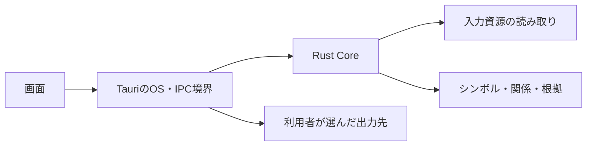

# legacists 設計書

[要件定義書](requirements.md)の実現方法を管理する。[設計Issue #2](https://github.com/kz-oshiro/legacists/issues/2)は設計完了で閉じ、製品実装・全体検証・公開は[後続Issue](development.md#開発の進め方)で扱う。現時点は初期設計案で、コード・API・ビルド・検証基盤は未実装。具体的なライブラリ、API名、パスは設計確定と実装に合わせて更新する。

## 構成と依存方向

アプリとCoreは単一リポジトリで管理する。Rust Coreは独立したライブラリクレートとし、Tauriに依存させない。CLIが必要になった場合も同じCoreを呼ぶ。

```text
legacists/
├── crates/
│   └── legacists-core/       # 静的解析・参照解決・グラフ問い合わせ
├── apps/
│   └── desktop/
│       ├── src/             # フロントエンド
│       └── src-tauri/       # OS・IPC境界とCoreの呼び出し
├── xtask/                   # 将来の共通実行入口
├── test-support/            # 将来の合成データ・生成器
└── docs/
```

上記は予定配置。初期段階で空のクレートや未使用のCLIを増やさない。TXT生成はまずCoreの出力モジュールとし、保存先の選択・書き込みはアプリ側で扱う。規模や別用途が生じた段階で分離を検討する。



| 部分 | 責務 | 持たせない責務 |
| --- | --- | --- |
| Core | ファイル列挙・復号、構文解析、シンボル抽出、参照解決、診断、問い合わせ、出力内容の構築 | 画面状態、OSダイアログ、外部AIへの接続 |
| Tauri境界 | 選択されたプロジェクトの管理、バックグラウンド処理、IPC検証、保存先の制御 | 独自の解析ロジック |
| フロントエンド | ツリー・検索・グラフ・ソース・出力対象の表示と操作 | 全AST・全ソース・全グラフの常時保持、任意のOS操作 |

## 技術の採用状況

| 項目 | 方針・候補 | 決定条件 |
| --- | --- | --- |
| デスクトップ | Tauri、解析CoreはRust | 採用方針。単一EXE・既存WebView2での最小起動確認と依存検査で版を決め、配布条件を満たせなければGUI方式を見直す |
| フロントエンド | Vue 3 + TypeScript + Vite | 候補。必要なUI部品との連携と保守性を確認する |
| ペイン配置 | Dockview | 候補。タブ・分割・サイズ変更を小さな試作で確認する |
| ソース表示 | Monaco Editor | 候補。読み取り専用表示、位置移動、同梱資材とworkerを確認する |
| グラフ表示 | Cytoscape.js | 候補。集約・展開と表示件数を制御できることを確認する |
| 構文解析 | Tree-sitterなど | 候補。Q-01の構文・JSP混在領域・XHTML・XML・プロパティファイルの形式への適合性を確認する |

ライブラリ採用時には保守状況・API・ライセンス・既知の脆弱性を現在の一次資料で確認し、依存版を固定する。過去の会話の版番号や性能評価を採用根拠にしない。

## 解析の流れ

1. プロジェクトの基準フォルダと対象・除外条件を確定し、読み取る資源を列挙する。リンクやフォルダ外参照を追う方針は境界試験とともに決める。
2. ファイルごとにUTF-8・SJIS系（CP932を含む）を判定し、手動指定で修正できるようにする。復号後に言語ごとの構文解析を行い、復号失敗と未対応構文を別の診断として残す。置換文字で読み取り成功にしない。
3. シンボル索引を使って参照先を解決する。JSP・XHTMLの参照、JS・form送信、XML・プロパティ設定とJavaの連携は、対応すると定めた記法・設定形式ごとの規則として追加する。
4. 根拠付きのグラフと診断を作り、概要集約・近傍探索・呼び出し元/先の問い合わせに使用する。
5. ツリーやグラフで一件ずつ手動選択したファイルからTXTを構築し、確認後に指定された場所へ保存する。関連ファイルを自動追加しない。

入力コードやビルドスクリプトを実行して解決しない。動的呼び出しや候補が複数ある関係は、確定した関係と区別する。対応する構文と解決規則の契約は、Q-01決定後にサンプルとセットで記述する。

XML・プロパティの値は、採用した設定形式の規則に基づいて参照として扱う。設定値を一律に依存関係へ変換しない。設定を介した関係では、参照元と対応する設定の記述を根拠として確認できるようにし、解決できない値や識別子を推測で確定しない。対象では参照先が直接書かれている見込みのため、ファイル名・パス・クラス名などの直接記載から対応形式を具体化する。実際の記法と解決規則、設定のキー・IDを介した参照の要否はQ-01で確認する。

## データモデル案

| データ | 主な情報 |
| --- | --- |
| 資源 | プロジェクト内のID、相対パス、言語、文字コード、読み取り状態 |
| シンボル | ID、種類（ファイル・クラス・メソッドなど）、名前、所属、ソース位置 |
| 関係 | ID、起点、種別、解決状態、解決済みの参照先または候補・未解決先の表現、根拠 |
| 根拠 | 資源ID、ソース範囲、抽出規則、未解決や推定の理由 |
| 診断 | 安定したエラー番号、重大度、対象資源・位置、処理段階・規則、判明した原因と原因候補、調査への影響、確認項目・対処手順 |
| 出力選択 | 選択した資源・シンボル・関係、ソースの包含範囲、サイズ制限 |

関係の種別はimport・メソッド呼び出し・JSP include・スクリプト参照・送信・設定上の対応などを分ける。importをメソッドの呼び出しと同一視しない。解決状態は少なくとも確定・候補・未解決を識別する。

概要グラフの集約は元の関係を保持したまま導出する。関係数の定義、IDの安定範囲、位置の単位、同名・オーバーロード・変更後の整合性はAPI契約の確定前に決める。

## 問い合わせと画面

初期版の関係グラフはファイルをノードとし、ファイル間の関係と根拠位置を表示する。クラス・メソッドをノードにした掘り下げや、メソッド単位の詳細な影響追跡は将来の拡張候補とする。内部のシンボル情報は採用するファイル間の関係抽出に必要な範囲で扱い、メソッド呼び出し全体の解析を初期版の必須条件にしない。

| 画面 | 表示・操作 | 要件 |
| --- | --- | --- |
| Explorer・検索 | フォルダツリー、名前・相対パスの検索、起点の選択 | R-01 |
| Overview | フォルダ・パッケージ単位の集約と掘り下げ | R-04 |
| Graph | 近傍探索、起点変更、種類・深度の絞り込み、集約・展開 | R-02、R-03、R-06 |
| Source・Details | 読み取り専用ソース、根拠位置、関係種別、解決状態 | R-05、N-04 |
| AI Export | 調査対象の選択、ソースを含む調査TXTの内容確認・保存 | R-07、N-03 |
| Diagnostics | 解析エラー・未解決の一覧と詳細、影響・確認項目・対処手順、人間向けエラーレポートの表示・TXT保存 | R-08、N-04、N-07 |
| Settings | 文字コード指定、TXT容量上限、設定の既定・現在の保存先、保存先変更・保存データ削除 | R-09、R-10 |

全体グラフはRust側で保持し、画面には検索結果・集約結果・現在の近傍・必要なソースだけを返す。大量データをVueの深いリアクティブ状態として保持しない。上限・ページング・遅延読み込みは性能基準とセットで決め、省略を画面に示す。

IPCはプロジェクトを開く、解析の開始・進捗・キャンセル、検索、概要・近傍取得、ソース範囲取得、TXT保存を責務ごとに分ける。これはAPIの責務案であり、コマンド名や型は未確定。解析セッションを識別し、古い結果やキャンセル後の応答を新しい画面状態へ混ぜない。

ソース更新の反映は手動再解析とする。出力前に解析時点からのファイル変更を確認し、変更があれば再解析を案内する。選択・プレビュー・保存に使う本文と関係を同じ解析時点へ揃える（R-11）。

## 出力・保存・境界

- TXTにはファイル一覧、相対パス、ソース全文、ソース位置、関係と根拠、未解決・未対応の説明を含める。順序を決め、同じ入力・選択・設定から同じ内容を生成する。
- 復号できた選択ソースは構文解析に失敗しても「未解析」と明記して出力できる。エラーレポート側の本文非包含処理を共用して、調査TXTをマスク・要約・省略しない。
- TXTとエラーレポートはUTF-8・BOMなしを既定とする。調査TXTは通常一つ、既定上限800,000バイトを超えれば連番に分割する。見出し・関係情報も含む符号化後の容量を計算し、保存前に容量と分割数を表示する。上限は設定変更可能とする。
- 分割はファイル境界を優先し、大きいソースは行単位で分け、相対パス・行範囲・続きの情報を付ける。一行だけで上限を超える場合も文字の途中で切らず継続部分を明示し、各TXTの上限と本文の欠落防止を両立する。具体的な書式はQ-04で決める。
- 元ファイルの読み取りと出力先の書き込みを分離する。UIから受けたパスをそのまま任意ファイル操作に使わない。
- ソースはテキストとして表示する。コードの実行、任意のシェル呼び出し、CDNへの依存を避け、必要なIPCと資材だけを含める。
- 永続保存は選択状態・文字コード指定・除外設定などの設定に限り、ソース本文と解析結果のキャッシュを作らない。設定の既定・現在の保存先を表示し、変更・削除を設ける。WebView2の作業データも管理・削除対象に含め、ソースをブラウザーの永続領域へ保存しない。パス・移行・削除の具体手順はQ-05で決める。
- データ削除はアプリが管理する保存データに限定し、解析元ファイルや出力済みTXTを削除しない。導入時に保存・削除の扱いをREADMEとアプリ内説明へ記載する。

## 解析エラー時の作業者向けレポート

解析中に問題が起きたとき、作業者が自分の端末で切り分け・対処できるよう、R-08・N-07を満たすエラーレポートを画面に表示し、TXTとして保存できるようにする。AI向け調査TXTには選択したソースをそのまま出力し、エラーレポートとは目的と生成処理を分ける。

| レポートの項目 | 人間が分かること |
| --- | --- |
| 発生状況 | エラー番号、処理段階、重大度、対象の相対パス・クラス名・行や列、アプリ版・必要な実行環境から、どこで何が起きたかを確認できる |
| 解析結果への影響 | 完了した範囲、失敗・未解析の範囲、関係を判断できない範囲が分かる |
| 確認・対処の手順 | エラー種別に応じて、読み取り権限、文字コード、対応記法、参照先の有無など、具体的に確認する場所・項目と次の対処が分かる。対象箇所は端末内のソース表示で確認できる |
| 解決できない場合 | 未判明の事項、追加で確認する情報、改修担当へ伝えるエラー番号・再現操作・確認結果が分かる。実ソースの提出を要求しない |

エラーレポートはソース本文・抜粋・設定値を添付せず、相対パス・クラス名・位置と説明から作業者が実ソースを確認できるようにする。入力断片を含み得るパーサーやOSの生のエラー文は、エラー番号・定型説明・必要な構造化情報へ変換し、本文や絶対パスをそのままレポートへ混入させない。原因が特定できない場合は不明と示し、原因候補を断定しない。

読み取り・復号・構文解析の失敗、参照解決時の問題、解析器の内部エラーを起点に、エラー分類と具体的な確認・対処・追加調査の手順をQ-08で定める。未解決の参照は解析器の異常と区別する。作業者が対処できない場合の改修は、レポートと確認結果、公開可能な合成再現例を使い、改修担当のCodexが実ソースを読めることを前提にしない。

## 配布と実行環境

GitHub Releaseの配布ZIPには実行EXE一つだけを入れ、EXE単独の移動後も起動できることを条件とする。画面・解析の資材と必要なライブラリはEXEに内包し、隣接DLL・CMD・設定ファイルを要求しない。操作説明・ライセンス表記はアプリ内に置く。追加インストール・管理者権限・起動時ダウンロードは要求しない。

WebView2は端末の既存Runtimeを利用する。[Microsoftの配布資料](https://learn.microsoft.com/en-us/microsoft-edge/webview2/concepts/distribution)を参照し、Runtimeを別ファイルでZIPへ同梱する方式は採用しない。利用者のdocs-search動作実績は環境方針の根拠とし、legacistsの単一EXE起動は別途検証する。Tauriで条件を満たせなければGUI方式を見直す。

## 要件と検証の対応

| 対象 | 確認する内容 | 要件 |
| --- | --- | --- |
| Coreの単体・契約試験 | 合成ソースからの抽出・参照解決、同名・曖昧・未解決、根拠位置、集約と元関係の対応 | R-02〜R-06、N-04、N-06 |
| Coreと入出力の試験 | UTF-8・CP932の混在と手動指定、復号失敗、未解析ソースの出力、元ファイルの非変更、手動選択範囲を確認する。日本語と見出しを含めた800,000バイト境界、巨大ファイル・長い一行の分割と全文保持、出力前の変更検知を検証する | R-01、R-07、R-09、R-11、N-03 |
| エラーレポートの試験 | 合成データで解析時の失敗を起こし、番号・発生箇所・原因区分・影響・具体的な確認手順・対処と追加調査の案内を確認。レポートには本文・設定値を添付せず、相対パス・クラス名・位置を保持して画面表示・TXT保存できることを確認する | R-08、N-04、N-07 |
| フロントエンド試験 | 検索・手動選択・展開・根拠表示・再解析・出力プレビュー・エラーレポートを検証する。設定の保存・再読込、既定と現在の保存先、変更・削除を確認し、元ソース・出力済みTXTが削除されないことを確認する | R-01、R-03〜R-11 |
| 実EXE結合試験 | ZIP内がEXE一つだけであることを確認し、展開後とEXE単独の移動後に通常権限・オフライン・追加インストールなしで起動する。同じEXEでTauri IPC、Core、内包資材と設定・保存・削除の操作結果を確認する | N-01、N-02と対象機能 |
| 性能・環境試験 | 数百ファイル程度を起点に固定データ・端末・性能基準を定め、時間・メモリ・応答を測定。WebView2と対象端末の条件を記録 | N-01、N-05 |

固定データは公開可能な合成ソースで作り、社内ソースをこの公開リポジトリへ入れない。自動試験・実EXE・OS固有の操作・性能測定の証拠を区別する。実行と報告のルールは[開発手順](development.md#検証の方針)に従う。

## 次に確定する設計

要件定義Issueで確定した範囲に対し、設計Issueで入力サンプル・期待関係・Core API・画面操作・入出力・保存・診断・確認手順を対応付ける。実装に必要な設計判断と試験設計が揃い、文書の静的確認・コミット・pushと後続への引き継ぎを完了したら#2を閉じる。製品実装・最小EXEの起動確認は#3、全体検証・性能測定は#4、公開は#5の対象とする。
